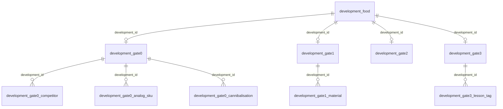

# Development and gate data

Every development process has one permanent ID: `development_food.id` (`Food.pk`). That ID follows the process from Gate 0 through Gate 3. Moving between gates, editing a recipe, or returning a gate for corrections does not create a new development ID.

Each gate has its own table. Its `development_id` is both the primary key and a foreign key to `development_food.id`. For development **42**, the Gate 0, Gate 1, Gate 2 and Gate 3 rows all use **42**. The gate tables have no separate auto-incrementing gate ID.

## Main tables

| Table | Purpose | Key |
| --- | --- | --- |
| `development_food` | Process identity, owner, current gate and review state | `id` |
| `development_gate0` | Product brief: `product_name`, `category`, pricing inputs, targets and planned launch date | `development_id` |
| `development_gate1` | Concept, tasting, material, capacity, packaging and marketing fields | `development_id` |
| `development_gate2` | Production and launch readiness, final pricing, quality limits and launch date | `development_id` |
| `development_gate3` | Day-45 review, actual performance, complaints and lessons | `development_id` |

Gate values have individual columns. Dates use date columns; counts use integer columns; money, percentages and measured values use decimal columns. Text fields and dropdown codes use text/string columns. Gate 0's product name and category continue to update the summary fields on `development_food`, which the dashboard uses.

Draft records may be incomplete. Optional numeric and date columns use `NULL` for an unknown value. A numeric **0** remains a recorded value and is distinct from `NULL`.

## Gate 0 files

`development_gate0_files` stores one row per Gate 0 upload. Its columns are `id`, `development_id`, `slot_code`, `file`, `original_filename`, `uploader_id`, `uploaded_at` and `activity_id`. The development foreign key uses the same permanent process ID as the gate tables. Slot codes identify G0-F1 through G0-F4, with multiple uploads retained per slot.

The `file` column contains the storage path. File contents remain under `.store/media/activities/<development_id>/`. An optional link to `development_activity` connects the file to its audit event. Gate 0 file metadata is stored in the files table; the audit row keeps its author, timestamp and event text. Existing Gate 0 uploads migrate with their original paths, filenames and timestamps. Both the dedicated file download URL and previous activity-based download links require authentication.

## Repeating rows and selections

Repeating form rows and multi-select values have separate child tables. Each child links to its gate using a `development_id` foreign key and has a `position` column. The combination of development ID and position is unique within each child table, so the entered order is retained.

| Table | Stored values |
| --- | --- |
| `development_gate0_competitor` | Competitor product, price and weight |
| `development_gate0_analog_sku` | Analog SKU and units per store per day |
| `development_gate0_cannibalisation` | Affected SKU and sales percentage |
| `development_gate1_material` | Material, specification status, price/kg, MOQ and second-source status |
| `development_gate0_improvement_reason` | Selected improvement-reason codes |
| `development_gate0_daypart` | Selected dayparts |
| `development_gate0_allergen` | Selected allergen codes |
| `development_gate0_high_risk_input` | Selected high-risk ingredients |
| `development_gate3_lesson_tag` | Selected lesson tags |

Partial repeating rows remain supported. For example, a competitor's name can be recorded while its price is still unknown.



The four Gate 0 selection tables follow the same parent/child relationship as the repeating-row tables shown above.

## Joining gates for the same process

Join on `development_id` to identify rows belonging to the same development:

```sql
SELECT
    gate0.development_id,
    gate0.product_name,
    gate0.category,
    gate2.vendor_invoice_price,
    gate2.launch_date
FROM development_gate0 AS gate0
LEFT JOIN development_gate2 AS gate2
    ON gate2.development_id = gate0.development_id
WHERE gate0.development_id = 42;
```

The `LEFT JOIN` also returns the Gate 0 brief when the corresponding Gate 2 row has not been created yet. The Django models expose the same relationship through `Gate0.development`, `Gate1.development`, `Gate2.development` and `Gate3.development`.

## Calculated values

Calculated values such as COGS, margins and launch-day differences remain read-only in the forms and are derived from their source inputs. The existing calculation functions use `Decimal` and recompute values for the workflow and display. Stored decimal snapshots can be queried for reporting; calculations that require full intermediate precision should use the calculation functions, particularly when running the local SQLite database.

## Existing data and the legacy archive

The data migration copies existing Gate 0–3 JSON payloads into typed columns and ordered child rows. Existing development IDs are retained. The original payloads are preserved in `development_gate_data_archive`, together with their source gate, original source identifier, development ID and conversion issues.

The active gate tables have no JSON payload column. Raw JSON is retained in the archive to preserve removed fields, older free-text values and values that cannot be converted safely. Unconvertible numeric or date values leave their typed columns `NULL` and can be surfaced for manual correction; the original payload remains available after correction.

Some historical source rows may refer to a development that no longer exists. Those payloads are archived with their original numeric reference. The migration does not invent a replacement process or assign them to another development. The archive's `development_id` is therefore an informational number rather than an enforced foreign key. Unrelated pre-existing recipe or audit orphan records are outside this gate-storage conversion.

New development creation initializes the four gate records with the same development ID. Gate saves update the parent row and replace its ordered child rows in one transaction, preserving one row per development per gate.
